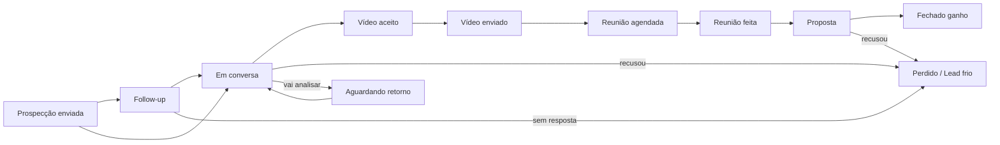
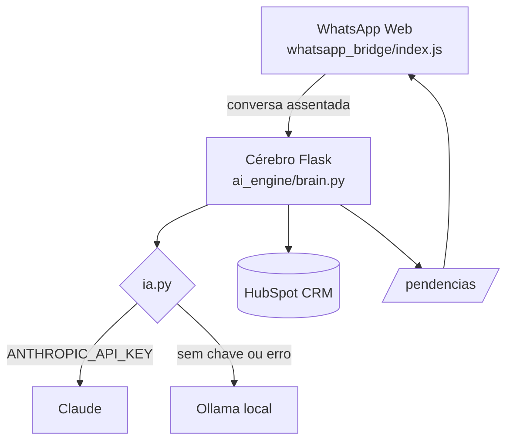

# whatsapp-sales-agent

Agente de vendas para WhatsApp que **lê as conversas com leads, descobre em que etapa do funil cada um está e mantém o CRM (HubSpot) organizado**. Também responde a perguntas da equipe num grupo ("Chopp, quem pediu o vídeo e ainda não recebeu?"), sugere mensagens de follow-up e pesquisa dados de empresas com conferência dupla.

> Todos os dados em `data_storage/` são **fictícios** (nomes inventados, telefones 555). Nenhum dado real faz parte do repositório.

## Como funciona



O lead pode pular etapas (ex.: aceitar o vídeo na primeira resposta). Follow-ups só contam enquanto o lead não respondeu.



## Componentes

| Arquivo | Função |
|---|---|
| `whatsapp_bridge/index.js` | Ponte com o WhatsApp Web (whatsapp-web.js): envia conversas ao cérebro e posta alertas no grupo da equipe |
| `ai_engine/brain.py` | Servidor Flask: classifica o estágio, calcula pendências e atualiza o CRM |
| `ai_engine/ia.py` | Camada de IA com **fallback Claude → Ollama** |
| `ai_engine/assistente.py` | Chat da equipe: fichas, mensagens, roteiros de vídeo, pesquisa e cadastro |
| `ai_engine/hubspot_setup.py` | Cria o funil e as propriedades personalizadas no HubSpot |
| `ai_engine/importar_planilha.py`, `sincronizar_planilha.py` | Importa/sincroniza leads de uma planilha |
| `ai_engine/corrigir_lead.py` | Correção manual do estágio de um lead |
| `scripts/gerar_dados_ficticios.py` | Regenera os dados fictícios de exemplo |

## Fallback Claude → Ollama

`ia.py` escolhe o provedor assim:

1. Se existe `ANTHROPIC_API_KEY`, usa Claude (modelo em `CLAUDE_MODELO`).
2. Se não há chave, ou se a chamada ao Claude falha, cai para o **Ollama** local (`OLLAMA_MODEL`, padrão `qwen3:14b`).
3. `IA_PROVEDOR=claude|ollama` força um dos dois.

## Instalação

Requisitos: Python 3.11+, Node 20+, (opcional) [Ollama](https://ollama.com) com um modelo baixado.

```bash
# 1) Cérebro
cd ai_engine
python -m venv venv && venv\Scripts\activate      # Windows
pip install -r requirements.txt
cp .env.example .env                               # preencha os valores
python hubspot_setup.py                            # cria funil e propriedades (uma vez)
python brain.py

# 2) Ponte WhatsApp (outro terminal)
cd whatsapp_bridge
npm install
node index.js                                      # escaneie o QR Code
# alternativa: node index.js --numero 5511999990000  (código de pareamento)
```

No grupo da equipe envie `!chopp` para definir onde os alertas chegam e `!ajuda` para ver os comandos.

## Segurança

- O `.env`, a sessão do WhatsApp (`.wwebjs_auth`) e dados reais **não** devem ser commitados (veja `.gitignore`).
- Com `ATUALIZAR_HUBSPOT=0` (padrão) o agente só simula; use `1` para gravar de verdade.
- Respeite as regras do WhatsApp e as leis de privacidade (LGPD/CCPA) ao automatizar conversas.

## Licença

MIT
